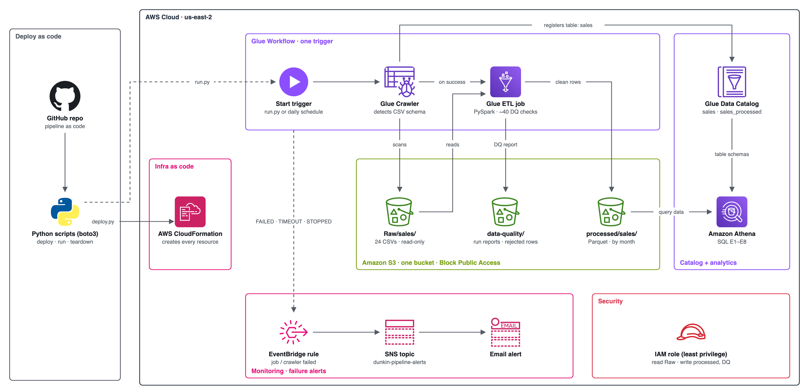
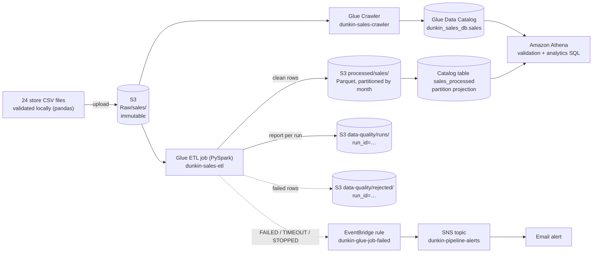
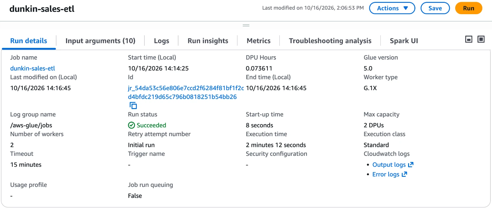
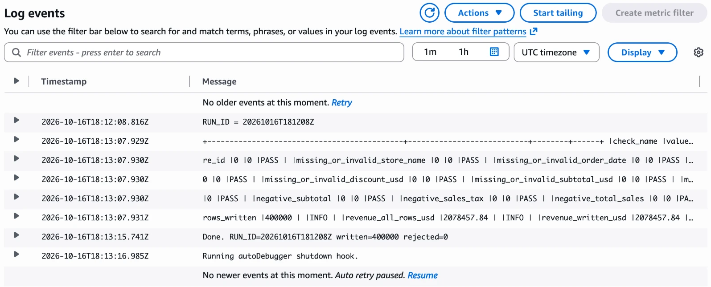
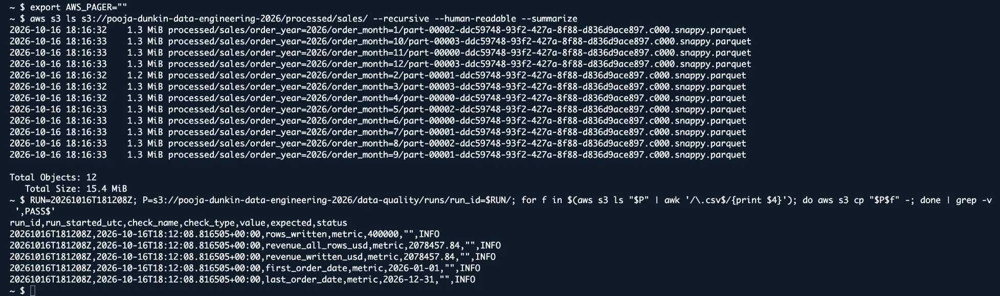
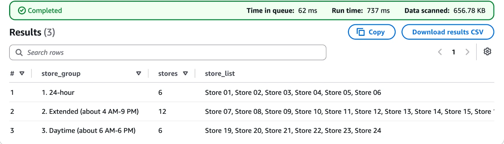
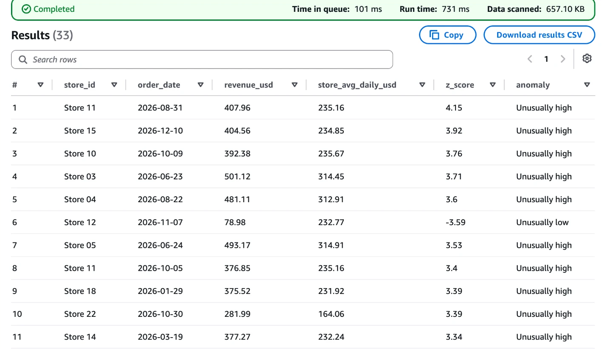
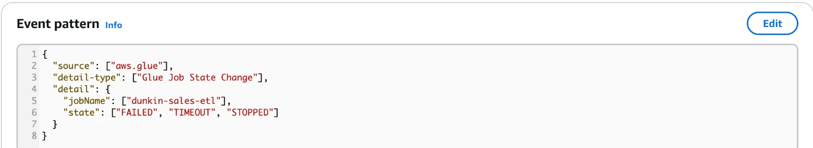
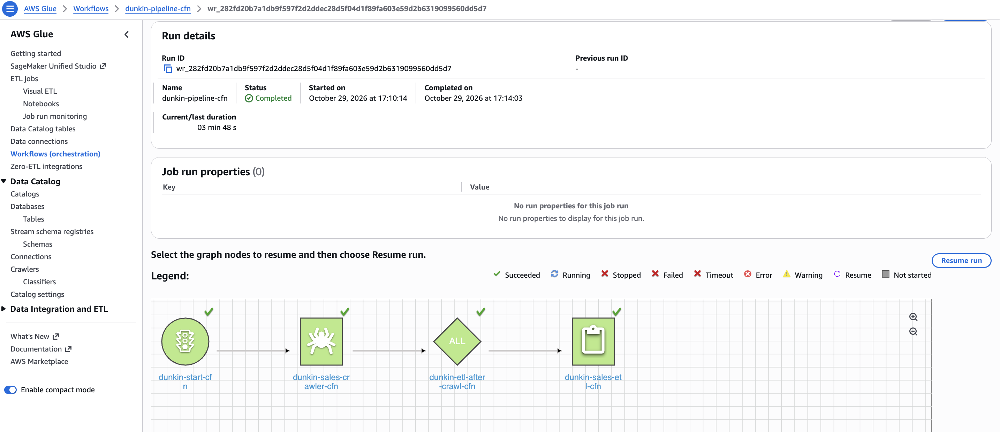
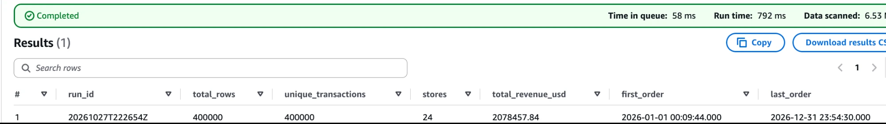

# End-to-end AWS batch data pipeline: Dunkin' Donuts franchise sales (simulated)

A serverless batch pipeline on AWS that ingests, catalogs, validates, transforms and analyzes **400,000 simulated sales transactions** from **24 New Jersey franchise stores** (calendar year 2026).

> **Data notice:** the dataset is **synthetic**, made for learning and portfolio purposes. It is not real Dunkin' Donuts corporate data.

**Stack:** Amazon S3 · AWS Glue Crawler · AWS Glue Data Catalog · AWS Glue ETL (PySpark, Glue 5.0) · Amazon Athena (SQL) · Amazon EventBridge · Amazon SNS · IAM · CloudWatch · Python (pandas)

---

## Architecture



<sub>Official AWS icons. Generated by [`docs/architecture/draw_architecture.py`](docs/architecture/draw_architecture.py).</sub>

### Data flow



### S3 layout (one bucket, separated by purpose)

```
s3://pooja-dunkin-data-engineering-2026/
├── Raw/sales/                     24 source CSVs (read-only for the ETL role)
├── processed/sales/               order_year=2026/order_month=1..12/*.snappy.parquet
├── data-quality/
│   ├── runs/run_id=<RUN_ID>/      check results for every batch run
│   └── rejected/run_id=<RUN_ID>/  rows that failed a check (only if any)
└── athena-results/                Athena query output
```

---

## Pipeline stages

| Stage | What | How |
|---|---|---|
| **A. Ingestion** | 24 store CSVs → S3 `Raw/sales/` | Raw files are never modified; the ETL role can only read them |
| **B. Cataloging** | Register raw CSV schema | Glue Crawler → `dunkin_sales_db.sales` (19 columns, header detected); validated in Athena |
| **C. Transformation** | Clean, type and enrich | Glue PySpark job: string → `date`/`timestamp`/`int`/`decimal(12,2)`; adds `order_hour`, `day_of_week`, `store_number`, lineage columns; writes Snappy Parquet partitioned by year/month |
| **D. Data quality** | Repeatable checks on every run | ~40 rules (critical / error / warning); per-run report keyed by `RUN_ID`; bad rows quarantined, never silently dropped; job stops before writing if a critical check fails |
| **E. Analytics** | Business questions in SQL | Athena over `sales_processed` (partition projection, no crawler needed) |
| **F. Monitoring** | Failure alerting | EventBridge rule on Glue job state `FAILED` / `TIMEOUT` / `STOPPED` → SNS email; covers data-quality failures too, because a failed critical check fails the job. Tested end to end. See [monitoring/](monitoring) |
| **G. Deployment and orchestration** | Everything as code | CloudFormation template creates all resources; a Glue workflow runs crawler → ETL from one trigger (optional schedule). See [Deploy in one command](#deploy-in-one-command) |

---

## Results (verified)

| Metric | Value |
|---|---|
| Transactions processed | **400,000** (24 files, 24 stores) |
| Rows rejected by quality rules | **0** (all checks PASS in 3 runs) |
| Revenue reconciliation | Raw **$2,078,457.84** = processed **$2,078,457.84** |
| Storage: CSV → Parquet | **71.9 MiB → 15.4 MiB** (≈ 4.7× smaller, 12 files) |
| Athena data scanned | Full scan of raw CSV table: **71.92 MB**; store-group query (E7) on Parquet: **656.78 KB** (≈ 110× less: only the needed columns are read) |
| Glue job run | 2 min 12 s execution, 8 s start-up, 2 × G.1X workers |
| Cost per batch run | 0.0736 DPU-hours × $0.44 ≈ **$0.03** |
| Idempotency | Repeated runs → identical output, no duplicates; a deliberately stopped run was fully recovered by one rerun |
| Failure alert | Test run stopped → `STOPPED` email delivered via EventBridge → SNS within seconds |
| Deploy as code | `deploy.py` created the full CloudFormation stack in one command; `run.py`: Glue workflow (crawler → ETL) completed in ≈ 4 min (ETL 125 s), P1 reconciliation all PASS; `teardown.py` removed the whole stack (2026-10-29) |

Details: [data quality](docs/data-quality.md) · [cost and cleanup](docs/cost-and-cleanup.md)

---

## Analytics (Amazon Athena)

| Query | Question answered |
|---|---|
| [E1](sql/04_analytics/E1_monthly_sales.sql) | Monthly revenue, transactions, average transaction value, month-over-month growth (`LAG`) |
| [E2](sql/04_analytics/E2_daily_sales_7day_avg.sql) | Daily revenue with a 7-day moving average (window frame) |
| [E3](sql/04_analytics/E3_revenue_by_store.sql) | Store ranking and share of total revenue (`RANK`, windowed `SUM`) |
| [E4](sql/04_analytics/E4_best_selling_products.sql) | Top 10 products by units sold |
| [E5](sql/04_analytics/E5_hourly_pattern.sql) | Sales by hour of day |
| [E6](sql/04_analytics/E6_day_of_week_pattern.sql) | Sales by weekday (normalised per day: 2026 has 53 Thursdays) |
| [E7](sql/04_analytics/E7_store_groups_by_operating_hours.sql) | Store comparison: groups stores by opening hours **derived from their sales**, which independently confirms the simulated design (6 × 24-hour, 12 × 4 AM–9 PM, 6 × 6 AM–6 PM) |
| [E8](sql/04_analytics/E8_daily_revenue_anomalies.sql) | Anomaly detection: store-days more than 3 standard deviations from the store's own average (z-score) |

Validation SQL: [raw](sql/01_raw_validation) · [processed](sql/03_processed_validation) · Table DDL: [`create_sales_processed.sql`](sql/02_ddl/create_sales_processed.sql)

### Key findings

- **Store design confirmed from the data (E7):** grouping stores by the hours in which they actually record sales gives exactly 6 × 24-hour (Store 01–06), 12 × extended 4 AM–9 PM (Store 07–18) and 6 × daytime 6 AM–6 PM (Store 19–24), with 22,000 / 16,500 / ≈11,667 transactions per store respectively.
- **Monthly trend (E1):** revenue is stable at about $170k–$177k per month; the highest is May ($177,468.89) and the lowest is February ($160,812.93), which is explained by February having only 28 days.
- **Products (E3/E4):** units sold are spread almost evenly across items (top: Original Blend coffee, 20,037 units), but **Lunch** earns the most revenue (≈ 23% of the total, top item: Chicken Sandwich at $165,146.84) because of its higher prices. Volume leaders and revenue leaders are different products.
- **Time patterns (E5/E6):** the busiest hours are in the 6 AM–5 PM window when all 24 stores are open (peak 1 PM, 5.8% of transactions). Average revenue per weekday varies by under 2% (Tuesday $5,630 to Saturday $5,734 per day).
- **Data-generation note:** the near-even product, hour and weekday distributions show that the simulator draws these uniformly. A next iteration could add realistic seasonality (morning rush, weekends, holidays) to make trend analysis richer.
- **Anomaly detection (E8):** 33 of 8,760 store-days (0.38%) are 3+ standard deviations from their store's normal daily revenue, mostly unusually *high* days (largest: Store 11 on 2026-08-31, $407.96 vs a $235.16 daily average, z = 4.15). Average daily revenue per store is about $313 for 24-hour stores, $233 for extended-hours stores and $164 for daytime stores. Because the data is randomly simulated, these outliers are statistical noise rather than real events; on real data, this query would flag days to investigate (promotions, outages, data errors).

---

## Engineering decisions

| Decision | Why |
|---|---|
| **Parquet + Snappy, partitioned by year/month** | Column format: Athena reads only the needed columns and months, so less data is scanned and costs are lower; month partitions keep file counts small (12) for 400k rows |
| **`decimal(12,2)` for money** | Exact cents; floating point would introduce rounding drift in sums |
| **Global `transaction_id` = `store_id-order_id`** | `order_id` is store-local and repeats across stores (378,000 repeats); a composite key makes every row unique |
| **Quarantine instead of drop** | Rejected rows land in `data-quality/rejected/run_id=…` with the rule names they broke, so nothing disappears silently |
| **Critical checks before writing** | A missing store file or a row-count mismatch stops the job **before** `processed/` is overwritten |
| **Per-run `RUN_ID`** | Every report, rejected file and processed row carries the run ID (traceability / lineage) |
| **Full-refresh overwrite** | Simple and idempotent for a 70 MB batch; reruns never duplicate data |
| **Partition projection instead of a second crawler** | No crawler runtime cost and no `MSCK REPAIR` after each run |
| **Dedicated least-privilege IAM role** | ETL can read `Raw/` but not write or delete it; write access only to `processed/` and `data-quality/`. See [iam/](iam) |
| **Event-driven alerting (EventBridge + SNS)** | No polling or extra compute; Glue publishes state changes for free, and the same rule catches crashes, timeouts and data-quality stops |
| **Job guards** | 2 workers (minimum), 15-minute timeout, 0 retries: a stuck job can't run up costs |

---

## Repository structure

```
├── README.md
├── infra/pipeline.yaml                   CloudFormation: the whole pipeline as code
├── glue_jobs/dunkin_sales_etl.py         Glue 5.0 PySpark ETL + data-quality job
├── sql/
│   ├── 01_raw_validation/                V1–V3: Athena checks on the raw CSV table
│   ├── 02_ddl/                           CREATE EXTERNAL TABLE for processed Parquet
│   ├── 03_processed_validation/          P1: raw ↔ processed reconciliation
│   └── 04_analytics/                     E1–E8 business queries
├── iam/                                  Least-privilege S3 policy for the ETL role
├── monitoring/                           EventBridge pattern + SNS failure-alert setup
├── scripts/                              deploy.py / run.py / teardown.py (boto3) + read-only cloudshell_checks.sh
├── local_prep/                           pandas scripts: validation, timestamp fixes, Transaction_ID
├── data/sample/                          100-row sample of one store file
└── docs/                                 Data dictionary, data quality, troubleshooting, cost, screenshots, architecture diagram
```

---

## Deploy in one command

The whole pipeline is defined as code in [`infra/pipeline.yaml`](infra/pipeline.yaml) (AWS CloudFormation): bucket, least-privilege IAM role, crawler, Glue ETL job, `sales_processed` table, Athena workgroup, **Glue workflow (crawler → ETL in one trigger)**, EventBridge failure rules and SNS alerts. Resource names end in `-cfn`, so the stack lives next to the console-built setup.

In AWS CloudShell (us-east-2), from the repo folder:

```bash
python3 scripts/deploy.py you@example.com   # create/update the stack, upload the ETL script and the 24 CSVs
python3 scripts/run.py                      # crawler -> ETL, then reconciles the result in Athena (~$0.10)
```

The scripts use Python + boto3 (both preinstalled in CloudShell).

- Confirm the SNS subscription email once to receive failure alerts.
- Optional daily schedule (06:00 UTC): `python3 scripts/deploy.py you@example.com --schedule on`. Off by default, so nothing runs or costs money unless started.
- CSVs come from the original bucket by default; pass a local folder as the second argument instead.

Teardown (empties the stack's bucket and deletes every stack resource; original setup untouched):

```bash
python3 scripts/teardown.py
```

---

## How to reproduce (manual console steps)

1. Create an S3 bucket (Block Public Access on) and upload the 24 CSVs to `Raw/sales/`.
2. Glue → Crawlers: target `s3://<bucket>/Raw/sales/` (**case-sensitive**), output database `dunkin_sales_db`. Run it.
3. Athena: set the query result location to `s3://<bucket>/athena-results/`; run [`sql/01_raw_validation`](sql/01_raw_validation).
4. IAM: create role `dunkin-glue-etl-role` (trusted entity: Glue) with `AWSGlueServiceRole` + [`iam/dunkin-s3-pipeline-access.json`](iam/dunkin-s3-pipeline-access.json).
5. Glue → ETL jobs → Script editor (Spark): paste [`glue_jobs/dunkin_sales_etl.py`](glue_jobs/dunkin_sales_etl.py); Glue 5.0, G.1X × 2, timeout 15 min, bookmarks off, retries 0. Run.
6. Athena: run [`sql/02_ddl/create_sales_processed.sql`](sql/02_ddl/create_sales_processed.sql), then [`sql/03_processed_validation`](sql/03_processed_validation) and [`sql/04_analytics`](sql/04_analytics).

7. Monitoring: SNS topic + email subscription, then an EventBridge rule with [`monitoring/eventbridge-glue-job-failed.json`](monitoring/eventbridge-glue-job-failed.json) targeting it. See [monitoring/](monitoring).

Problems met along the way and how they were solved: [docs/troubleshooting.md](docs/troubleshooting.md).

---

## Screenshots

**Glue ETL job run:** Succeeded in 2 min 12 s on 2 DPUs (0.0736 DPU-hours ≈ $0.03)


**Data-quality report in the job log:** all checks PASS, 400,000 written, 0 rejected, revenue reconciled


**Processed output:** 12 monthly Snappy Parquet files, 15.4 MiB in total


**E7: store groups derived from sales hours** (656.78 KB scanned vs 71.92 MB for a raw CSV scan)


**E8: anomaly detection** (33 store-days with |z| ≥ 3)


**Failure alerting:** EventBridge rule pattern (tested: a stopped run triggered an SNS email)


**Orchestration (deployed with CloudFormation):** Glue workflow run, crawler → ETL from one trigger, all steps succeeded in 3 min 48 s


**Processed table reconciliation (P1):** one run, 400,000 rows, 24 stores, revenue identical to raw


More: [raw-data profile](docs/screenshots/04-athena-raw-profile.png) · [least-privilege IAM role](docs/screenshots/11-iam-role-permissions.png) · [full checklist](docs/screenshots/README.md)

---

## Scalability

The **architecture** is serverless and distributed, so it scales horizontally. The **implementation** was deliberately sized for 400,000 rows (≈ 70 MB).

**Already scales without redesign**

| Component | Why |
|---|---|
| S3 | Effectively unlimited storage; raw / processed / quality zones kept separate |
| Glue Spark job | Distributed; more data → more workers (or auto scaling), same code |
| Parquet + partitioning | Athena reads only the needed columns and months (≈ 110× less data scanned than CSV here) |
| Athena | Serverless, no cluster to size |
| Partition projection | New partitions are discovered automatically, so there is no crawler or `MSCK REPAIR` step that slows down over time |
| Quality rules | Evaluated in parallel by Spark across workers |
| EventBridge → SNS | Event-driven, no infrastructure to scale |

**Sized for this dataset, and what would change at 100×–1000×**

| Current choice | Limitation at scale | Change |
|---|---|---|
| Full-refresh overwrite every run | Cost and runtime grow with all history | Incremental loads: Glue job bookmarks, or overwrite only new date partitions (`partitionOverwriteMode=dynamic`) |
| Duplicate check across the whole dataset | Re-compares every row every run | Check only the new batch against existing keys, or use **Apache Iceberg** tables with `MERGE` (supported in Glue 5.0) |
| Non-atomic overwrite | Readers could see partial data during a write | Iceberg / Delta tables: atomic commits and time travel |
| One Parquet file per month | Files become very large | Partition by date (or date + store) and cap file size (`maxRecordsPerFile`) |
| `coalesce(1)` for reports and rejected rows | One worker writes everything | Keep for small reports; let Spark write multiple files for large reject sets |
| Hard-coded 24 files / 24 stores | Adding a store fails a critical check | Read expected stores from a config table or job parameter |
| 2 workers, 15-minute timeout | Cost guards for 70 MB | Raise with data volume; enable auto scaling |
| Local pandas preparation | Runs on one machine | Move all cleaning into the Glue job (the checks already run there) |

---

## Roadmap

- [x] **Alerting:** EventBridge rule on Glue job state `FAILED` / `TIMEOUT` / `STOPPED` → SNS email
- [x] **Deployment as code:** CloudFormation stack + Python (boto3) deploy / run / teardown scripts
- [x] **Orchestration and scheduling:** Glue workflow runs crawler → ETL; optional daily schedule (off by default)
- [ ] **Quality trend table:** Athena table over `data-quality/runs/` to compare runs over time
- [ ] **Incremental loads:** process only new files (Glue job bookmarks) instead of full refresh
- [ ] **Dashboard:** Amazon QuickSight or Power BI on top of `sales_processed`

---

## Author

**Pooja Parmar**. Built as a hands-on AWS data engineering portfolio project.
